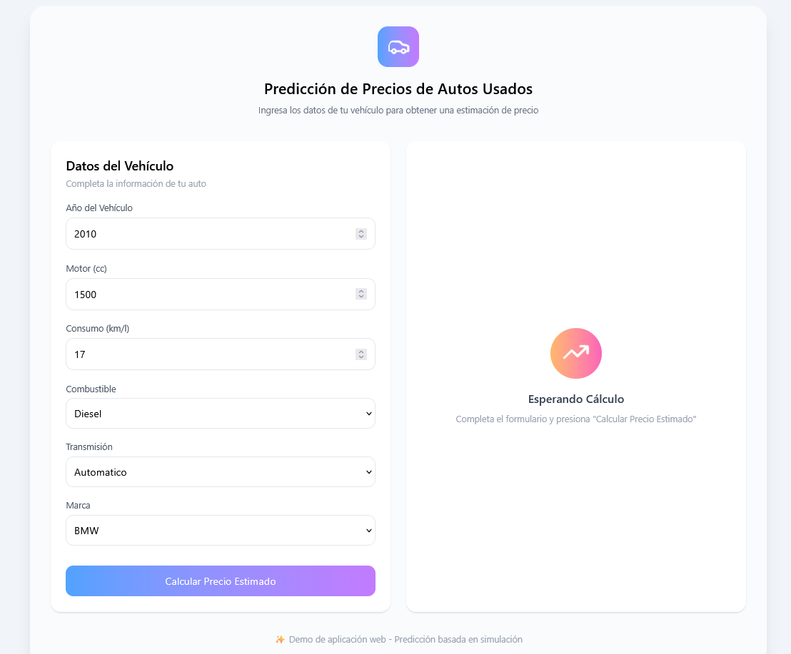
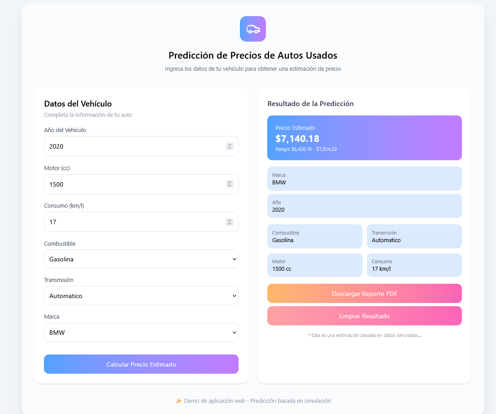
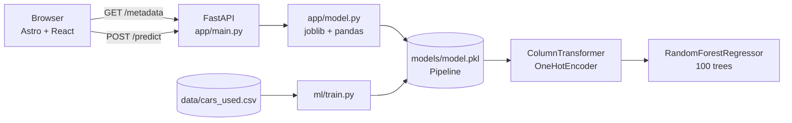

# 🚗 Car Price Predictor — ML App


A full-stack web app that estimates the market price of a used car from its
year, engine size, fuel efficiency, fuel type, transmission and brand.

The interesting part is the whole slice: a **scikit-learn pipeline** trained on a
10,000-row dataset, exposed through a **FastAPI** service, and consumed by an
**Astro + React + Tailwind** interface that stays in sync with the model through
a `/metadata` endpoint.

> ⚠️ **Dataset note:** the data is synthetic and used for demonstration
> purposes. Predictions are illustrative, not a real appraisal.

<p align="center">
  
  
</p>

---

## Table of contents

- [Features](#features)
- [Architecture](#architecture)
- [Tech stack](#tech-stack)
- [Project structure](#project-structure)
- [Quick start](#quick-start)
- [API reference](#api-reference)
- [Machine learning](#machine-learning)
- [Configuration](#configuration)
- [Deployment](#deployment)
- [Limitations & roadmap](#limitations--roadmap)
- [License](#license)

---

## Features

- **Price estimation** with a Random Forest regressor wrapped in a
  `ColumnTransformer` pipeline (no manual preprocessing at serving time).
- **Honest uncertainty band**: the API returns the 10th–90th percentile across
  the forest's 100 trees, so the UI can show a range instead of a single number.
- **Self-describing form**: brands, fuel types, transmissions and numeric ranges
  are fetched from `GET /metadata`, so the UI never offers a value the model was
  not trained on.
- **Real validation**: Pydantic field constraints on the server, inline field
  errors on the client, and unknown categories rejected with a `422`.
- **Connection status + retry**: the UI tells you when the API is unreachable
  instead of failing silently.
- **Print / PDF report**: the result panel is print-styled, so "Descargar
  Reporte PDF" produces a clean one-page report through the browser.
- Responsive layout, accessible labels and `aria-live` status messages.

---

## Architecture



---

## Tech stack

| Layer     | Technology                                        |
| --------- | ------------------------------------------------- |
| Frontend  | Astro 6, React 19, Tailwind CSS 4                 |
| Backend   | FastAPI, Uvicorn, Pydantic v2                     |
| ML        | scikit-learn 1.3 (Random Forest), pandas, joblib  |
| Tooling   | npm, Python venv, Git                             |

---

## Project structure

```text
car-price-predictor-ml-app/
├── backend/
│   ├── app/                    # HTTP layer
│   │   ├── main.py             # FastAPI app, CORS, routes
│   │   ├── model.py            # model loading + inference helpers
│   │   └── schemas.py          # Pydantic request/response models
│   ├── ml/
│   │   └── train.py            # training script (writes model + metadata)
│   ├── data/
│   │   └── cars_used.csv       # 10,000-row dataset
│   ├── models/
│   │   ├── model.pkl           # pre-trained pipeline (included)
│   │   └── metadata.json       # option catalog served by /metadata
│   ├── requirements.txt        # direct dependencies (pinned)
│   ├── requirements.lock.txt   # full pip freeze
│   └── .env.example
├── frontend/
│   ├── src/
│   │   ├── components/
│   │   │   ├── CarApp.jsx      # state + API connection
│   │   │   ├── PredictForm.jsx # form + validation
│   │   │   ├── ResultPanel.jsx # price, range, report
│   │   │   └── Field.jsx       # reusable labelled control
│   │   ├── lib/api.js          # typed-ish API client
│   │   ├── pages/index.astro
│   │   └── styles/global.css   # Tailwind + print styles
│   ├── public/                 # icons and illustrations
│   └── .env.example
├── docs/screenshots/
├── LICENSE
└── README.md
```

---

## Quick start

**Requirements:** Python 3.10–3.12, Node.js ≥ 22.12.

### 1. Backend

```bash
cd backend
python -m venv .venv
# Windows: .venv\Scripts\activate  |  macOS/Linux: source .venv/bin/activate
pip install -r requirements.txt

uvicorn app.main:app --reload
```

The API starts on `http://127.0.0.1:8000` — interactive docs at
`http://127.0.0.1:8000/docs`.

### 2. Frontend

In a second terminal:

```bash
cd frontend
npm install
cp .env.example .env      # optional: the default points to localhost:8000
npm run dev
```

Open `http://localhost:4321`.

### 3. (Optional) retrain the model

```bash
cd backend
python -m ml.train
```

This rewrites `models/model.pkl` and `models/metadata.json` and prints the
test metrics (MAE, RMSE, R²).

---

## API reference

| Method | Endpoint    | Description                                        |
| ------ | ----------- | -------------------------------------------------- |
| `GET`  | `/`         | Service card (name, version, docs link)            |
| `GET`  | `/health`   | Liveness probe; reports whether the model is loaded |
| `GET`  | `/metadata` | Brands, fuel types, transmissions and value ranges  |
| `POST` | `/predict`  | Estimate a price                                    |

### `POST /predict`

```json
{
  "year": 2018,
  "engine_cc": 1600,
  "mileage_kmpl": 16.5,
  "fuel_type": "Petrol",
  "transmission": "Manual",
  "brand": "Toyota"
}
```

```json
{
  "estimated_price": 7140.18,
  "currency": "USD",
  "interval": {
    "low": 6902.4,
    "high": 7381.9,
    "method": "p10-p90 across trees (dispersion heuristic, not a calibrated CI)"
  },
  "model": "RandomForestRegressor"
}
```

Errors use FastAPI's standard shape:

- `422` — validation failure or a category the encoder has never seen.
- `503` — the model file is missing (`python -m ml.train` was not run).

---

## Machine learning

### Dataset

`backend/data/cars_used.csv` — 10,000 synthetic listings with 12 columns.

| Column | Type | Role |
| --- | --- | --- |
| `make_year` → `year` | int | feature |
| `engine_cc` | int | feature |
| `mileage_kmpl` | float | feature |
| `fuel_type` | category | feature (`Petrol`, `Diesel`, `Electric`) |
| `transmission` | category | feature (`Manual`, `Automatic`) |
| `brand` | category | feature (10 manufacturers) |
| `price_usd` → `price` | float | target |
| `owner_count`, `color`, `service_history`, `accidents_reported`, `insurance_valid` | — | available but not used by the current model |

Quick profile of the target: median **$6,961**, range **$1,000 – $17,648**.
Electric cars average **$9,839** vs **$6,880** for petrol, and engine size is the
strongest linear signal (`r ≈ 0.68`), followed by model year (`r ≈ 0.43`) and
ownership count (`r ≈ −0.26`).

### Pipeline

```text
raw features
   ├── numeric  → passthrough
   └── category → OneHotEncoder(handle_unknown="ignore")
                        ↓
             RandomForestRegressor(n_estimators=100, random_state=42)
                        ↓
                   price (USD)
```

The pipeline is stored as a single object, so the API does not duplicate any
preprocessing logic — and cannot drift from training.

### Evaluation

`ml/train.py` prints the metrics on a 20 % hold-out split:

```bash
cd backend && python -m ml.train
```

```
Loaded 10,000 rows from .../data/cars_used.csv
Train rows: 8,000 | Test rows: 2,000
MAE : ...
RMSE: ...
R²  : ...
```

The numbers are not hard-coded in this README on purpose: re-run the script to
see the metrics for your environment.

---

## Configuration

### Backend (`backend/.env`)

| Variable         | Default                   | Purpose                          |
| ---------------- | ------------------------- | -------------------------------- |
| `ALLOWED_ORIGINS`| `*`                       | Comma-separated CORS origins     |
| `MODEL_PATH`     | `models/model.pkl`        | Override the model artifact      |
| `METADATA_PATH`  | `models/metadata.json`    | Override the option catalog      |

### Frontend (`frontend/.env`)

| Variable         | Default                  | Purpose                    |
| ---------------- | ------------------------ | -------------------------- |
| `PUBLIC_API_URL` | `http://127.0.0.1:8000`  | Base URL of the FastAPI app |

---

## Deployment

- **Backend** (Render, Railway, Fly.io): build with `pip install -r requirements.txt`
  and start with `uvicorn app.main:app --host 0.0.0.0 --port $PORT`.
  Set `ALLOWED_ORIGINS` to the deployed frontend URL.
- **Frontend** (Vercel, Netlify, Cloudflare Pages): build command `npm run build`,
  output directory `dist`, and set `PUBLIC_API_URL` to the deployed API URL.

Remember that `PUBLIC_API_URL` is baked in at build time: changing it requires a
new frontend build.

---

## Limitations & roadmap

- The dataset is **synthetic**; the model captures broad trends only.
- `owner_count`, `service_history` and `accidents_reported` are in the CSV but
  unused — adding them should improve accuracy the most.
- The reported interval is a dispersion heuristic, not a calibrated confidence
  interval (quantile regression or conformal prediction would fix that).
- Planned: model versioning + metrics logged per training run, a Dockerfile,
  and automated tests with `pytest` + `httpx`.

---

## License

MIT — see [LICENSE](LICENSE).

**Author:** Gonzalo Chavez · [@gonzalochavez0](https://github.com/gonzalochavez0)
