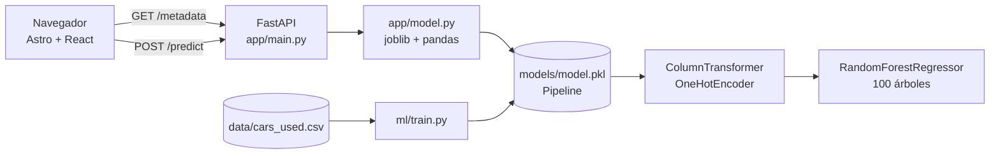

# 🚗 Car Price Predictor — App de ML


Aplicación web full-stack que estima el precio de mercado de un auto usado a
partir de su año, cilindrada, consumo, combustible, transmisión y marca.

Lo interesante es el recorrido completo: un **pipeline de scikit-learn**
entrenado con 10 000 registros, expuesto con **FastAPI** y consumido por una
interfaz en **Astro + React + Tailwind** que se mantiene sincronizada con el
modelo mediante un endpoint `/metadata`.

> ⚠️ **Nota sobre los datos:** el dataset es sintético y se usa con fines
> demostrativos. Las predicciones son ilustrativas, no una tasación real.

<p align="center">
  
  
</p>

---

## Tabla de contenidos

- [Características](#características)
- [Arquitectura](#arquitectura)
- [Stack tecnológico](#stack-tecnológico)
- [Estructura del proyecto](#estructura-del-proyecto)
- [Puesta en marcha](#puesta-en-marcha)
- [Referencia de la API](#referencia-de-la-api)
- [Machine learning](#machine-learning)
- [Configuración](#configuración)
- [Despliegue](#despliegue)
- [Próximos pasos](#próximos-pasos)
- [Licencia](#licencia)

---

## Características

- **Estimación de precio** con un Random Forest envuelto en un pipeline con
  `ColumnTransformer` (sin preprocesado manual al servir).
- **Rango de incertidumbre honesto**: la API devuelve el percentil 10–90 entre
  los 100 árboles del bosque, así la interfaz muestra un rango en lugar de un
  único número.
- **Formulario autodescriptivo**: marcas, combustibles, transmisiones y rangos
  numéricos salen de `GET /metadata`, por lo que la interfaz nunca ofrece un
  valor con el que el modelo no fue entrenado.
- **Validación real**: restricciones de Pydantic en el servidor, errores por
  campo en el cliente y categorías desconocidas rechazadas con un `422`.
- **Estado de conexión con reintento**: la interfaz avisa cuando la API no
  responde en lugar de fallar en silencio.
- **Informe imprimible / PDF**: el panel de resultados tiene estilos de
  impresión, así que "Descargar Reporte PDF" genera un informe limpio de una
  página desde el navegador.
- Diseño responsive, etiquetas accesibles y mensajes de estado con `aria-live`.

---

## Arquitectura



---

## Stack tecnológico

| Capa        | Tecnología                                        |
| ----------- | ------------------------------------------------- |
| Frontend    | Astro 6, React 19, Tailwind CSS 4                 |
| Backend     | FastAPI, Uvicorn, Pydantic v2                     |
| ML          | scikit-learn 1.3 (Random Forest), pandas, joblib  |
| Herramientas| npm, entorno virtual de Python, Git               |

---

## Estructura del proyecto

```text
car-price-predictor-ml-app/
├── backend/
│   ├── app/                    # capa HTTP
│   │   ├── main.py             # app FastAPI, CORS, rutas
│   │   ├── model.py            # carga del modelo e inferencia
│   │   └── schemas.py          # modelos Pydantic de entrada/salida
│   ├── ml/
│   │   └── train.py            # script de entrenamiento (modelo + metadata)
│   ├── data/
│   │   └── cars_used.csv       # dataset de 10 000 filas
│   ├── models/
│   │   ├── model.pkl           # pipeline preentrenado (incluido)
│   │   └── metadata.json       # catálogo de opciones que sirve /metadata
│   ├── requirements.txt        # dependencias directas (fijadas)
│   ├── requirements.lock.txt   # pip freeze completo
│   └── .env.example
├── frontend/
│   ├── src/
│   │   ├── components/
│   │   │   ├── CarApp.jsx      # estado + conexión con la API
│   │   │   ├── PredictForm.jsx # formulario + validación
│   │   │   ├── ResultPanel.jsx # precio, rango e informe
│   │   │   └── Field.jsx       # control reutilizable con etiqueta
│   │   ├── lib/api.js          # cliente de la API
│   │   ├── pages/index.astro
│   │   └── styles/global.css   # Tailwind + estilos de impresión
│   ├── public/                 # iconos e ilustraciones
│   └── .env.example
├── docs/screenshots/
├── LICENSE
└── README.md
```

---

## Puesta en marcha

**Requisitos:** Python 3.10–3.12 y Node.js ≥ 22.12.

### 1. Backend

```bash
cd backend
python -m venv .venv
# Windows: .venv\Scripts\activate  |  macOS/Linux: source .venv/bin/activate
pip install -r requirements.txt

uvicorn app.main:app --reload
```

La API queda en `http://127.0.0.1:8000` y la documentación interactiva en
`http://127.0.0.1:8000/docs`.

### 2. Frontend

En una segunda terminal:

```bash
cd frontend
npm install
cp .env.example .env      # opcional: por defecto apunta a localhost:8000
npm run dev
```

Abrí `http://localhost:4321`.

### 3. (Opcional) Reentrenar el modelo

```bash
cd backend
python -m ml.train
```

Esto regenera `models/model.pkl` y `models/metadata.json` e imprime las métricas
de test (MAE, RMSE, R²).

---

## Referencia de la API

| Método | Endpoint    | Descripción                                            |
| ------ | ----------- | ------------------------------------------------------ |
| `GET`  | `/`         | Ficha del servicio (nombre, versión, link a la doc)     |
| `GET`  | `/health`   | Sonda de estado; informa si el modelo está cargado      |
| `GET`  | `/metadata` | Marcas, combustibles, transmisiones y rangos de valores |
| `POST` | `/predict`  | Estima un precio                                        |

### `POST /predict`

```json
{
  "year": 2018,
  "engine_cc": 1600,
  "mileage_kmpl": 16.5,
  "fuel_type": "Petrol",
  "transmission": "Manual",
  "brand": "Toyota"
}
```

```json
{
  "estimated_price": 7140.18,
  "currency": "USD",
  "interval": {
    "low": 6902.4,
    "high": 7381.9,
    "method": "p10-p90 across trees (dispersion heuristic, not a calibrated CI)"
  },
  "model": "RandomForestRegressor"
}
```

Los errores usan el formato estándar de FastAPI:

- `422` — fallo de validación o una categoría que el encoder nunca vio.
- `503` — falta el archivo del modelo (no se ejecutó `python -m ml.train`).

---

## Machine learning

### Dataset

`backend/data/cars_used.csv` — 10 000 publicaciones sintéticas con 12 columnas.

| Columna | Tipo | Rol |
| --- | --- | --- |
| `make_year` → `year` | int | feature |
| `engine_cc` | int | feature |
| `mileage_kmpl` | float | feature |
| `fuel_type` | categoría | feature (`Petrol`, `Diesel`, `Electric`) |
| `transmission` | categoría | feature (`Manual`, `Automatic`) |
| `brand` | categoría | feature (10 fabricantes) |
| `price_usd` → `price` | float | variable objetivo |
| `owner_count`, `color`, `service_history`, `accidents_reported`, `insurance_valid` | — | disponibles pero sin usar en el modelo actual |

Perfil rápido del objetivo: mediana **USD 6 961**, rango **USD 1 000 – 17 648**.
Los autos eléctricos promedian **USD 9 839** frente a **USD 6 880** de los nafteros,
y la cilindrada es la señal lineal más fuerte (`r ≈ 0,68`), seguida del año
(`r ≈ 0,43`) y de la cantidad de dueños (`r ≈ −0,26`).

### Pipeline

```text
features crudas
   ├── numéricas  → passthrough
   └── categóricas → OneHotEncoder(handle_unknown="ignore")
                        ↓
             RandomForestRegressor(n_estimators=100, random_state=42)
                        ↓
                   precio (USD)
```

El pipeline se guarda como un único objeto, así que la API no duplica ninguna
lógica de preprocesado — y no puede desincronizarse del entrenamiento.

### Evaluación

`ml/train.py` imprime las métricas sobre un 20 % reservado para test:

```bash
cd backend && python -m ml.train
```

```
Loaded 10,000 rows from .../data/cars_used.csv
Train rows: 8,000 | Test rows: 2,000
MAE : ...
RMSE: ...
R²  : ...
```

Las métricas no están escritas a mano en este README a propósito: volvé a
ejecutar el script para verlas en tu entorno.

---

## Configuración

### Backend (`backend/.env`)

| Variable          | Por defecto            | Para qué sirve                    |
| ----------------- | ---------------------- | --------------------------------- |
| `ALLOWED_ORIGINS` | `*`                    | Orígenes CORS separados por comas |
| `MODEL_PATH`      | `models/model.pkl`     | Ruta alternativa del modelo       |
| `METADATA_PATH`   | `models/metadata.json` | Ruta alternativa del catálogo     |

### Frontend (`frontend/.env`)

| Variable         | Por defecto              | Para qué sirve              |
| ---------------- | ------------------------ | --------------------------- |
| `PUBLIC_API_URL` | `http://127.0.0.1:8000`  | URL base de la app FastAPI  |

---

## Despliegue

- **Backend** (Render, Railway, Fly.io): build con `pip install -r requirements.txt`
  y arranque con `uvicorn app.main:app --host 0.0.0.0 --port $PORT`.
  Configurá `ALLOWED_ORIGINS` con la URL del frontend desplegado.
- **Frontend** (Vercel, Netlify, Cloudflare Pages): comando de build `npm run build`,
  directorio de salida `dist` y `PUBLIC_API_URL` apuntando a la API desplegada.

Recordá que `PUBLIC_API_URL` se incrusta en tiempo de build: si la cambiás, hay
que volver a compilar el frontend.

---

## Próximos pasos

- Versionado del modelo con las métricas registradas en cada corrida de
  entrenamiento.
- Un Dockerfile para desplegar la API con un solo comando.
- Tests automatizados con `pytest` + `httpx` sobre `/predict` y `/metadata`.
- Sumar `owner_count`, `service_history` y `accidents_reported` como features: son
  las columnas del dataset con más impacto potencial en la precisión.

---

## Licencia

MIT — ver [LICENSE](LICENSE).

**Autor:** Gonzalo Chavez · [@gonzalochavez0](https://github.com/gonzalochavez0)
